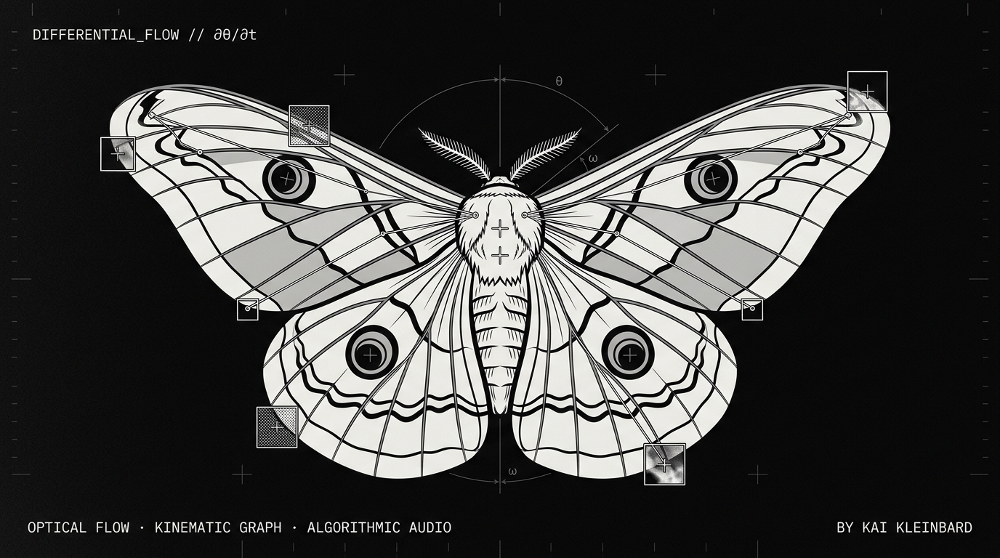

# DIFFERENTIAL_FLOW // ∂θ/∂t

Real-time optical flow, Shi-Tomasi corner detection, kinematic graph derivatives (`v`, `a`, `j`, `∂θ/∂t`), localized ROI pixel effects, and algorithmic audio synthesis in the browser.

**Live App:** https://cre8ture.github.io/pointed-flow/

Created by **Kai Kleinbard**.
